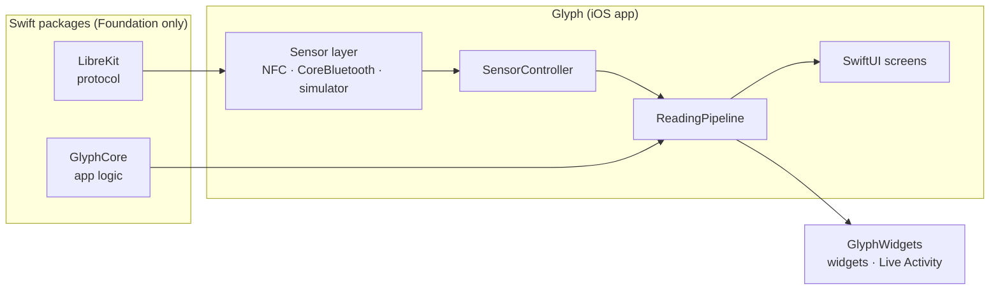
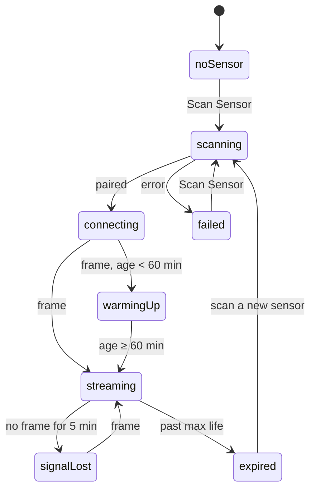

---
description:
    How Glyph works — the Libre 2 protocol over NFC and Bluetooth, the sensor lifecycle, the reading pipeline, and the
    adaptive layout.
---

# How it works

## The pieces

- **LibreKit** is the protocol, and nothing else: sensor types, CRC, the Libre 2 crypto, FRAM and BLE frame parsing,
  factory calibration, the trend, and frame decoding.
- **GlyphCore** is the logic that isn't about the protocol or the UI: units, statistics and the AGP, dedupe, the alert
  engine, the widget snapshot, and the test scenarios.
- **The app** wires them to hardware and storage. **`App/Shared`** is compiled into both the app and the widget
  extension.

Both packages are Foundation-only, so they build and test on Linux.

## Pairing over NFC

A scan does the following, in order:

1. Reads the **patch info** (NFC command `0xA1`): the product code, family, generation and region. LibreKit's
   `SensorType` classifies it, and throws a user-facing reason for any sensor Glyph can't read.
2. Reads and decrypts the **FRAM**: a 24-byte header (including the sensor's state), a 296-byte body (16 one-minute
   trend records, 32 fifteen-minute history records, and the sensor's age in minutes) and a 24-byte footer (region,
   maximum life, calibration). Each part carries its own CRC.
3. Refuses a sensor that **hasn't been started**, has **ended** or reports a **failure**. Glyph never activates sensors.
4. **Enables Bluetooth streaming** (`0xA1`, sub-command `0x1E`) with an unlock code Glyph picks at random. The sensor
   answers with its Bluetooth address.
5. Saves the sensor, and **back-fills** the FRAM's trend and history records through the pipeline.

## Streaming over Bluetooth

Glyph connects to the address it learned, and **unlocks** the stream with a payload built from that unlock code and a
counter. The sensor rejects a counter it has seen before, so **the counter is saved before the unlock is written**: a
crash between the two must never lead to a reuse.

About once a minute the sensor sends a **46-byte encrypted frame**. LibreKit decrypts it with the sensor's NFC ID into
44 bytes: seven trend records (0, 2, 4, 6, 7, 12 and 15 minutes ago), three history records on the 15-minute grid, the
sensor's age, and a CRC. Each raw record becomes mg/dL through **factory calibration**, behind the `GlucoseConverter`
protocol.

Inside the sensor's first hour the decoder reports **warming up** and stores nothing.

### The lifecycle

`SensorController` owns the lifecycle on the main actor. A watchdog moves a quiet sensor to **signal lost** after five
minutes. With the `bluetooth-central` background mode and CoreBluetooth state restoration, iOS relaunches Glyph in the
background to carry on receiving.

## The reading pipeline

**Readings are keyed by (serial, sensor age)**: the sensor's own minute counter, not the phone's clock. That key drives
dedupe, back-fill and the HealthKit sync identifier, so the same reading arriving from a live frame, a frame's history,
a FRAM back-fill or a re-pair is still one reading.

Every reading, live or back-filled, goes through `ReadingPipeline` in this order:

<figure class="gl-figure gl-reveal">

</figure>

1. **Dedupe** against stored readings by (serial, sensor age).
2. **Store** the new ones in SwiftData.
3. **Evaluate alerts** with GlyphCore's `AlertEngine`, a pure function of the reading, the rate and the saved
   `AlertState`. The no-data alert is a pending notification, rescheduled on every reading.
4. **Write to Health**, if enabled, as one batch. Simulated readings never go to Health.
5. **Update the Live Activity**, locally, with a stale date five minutes out.
6. **Refresh the widgets**, throttled to once every five minutes for the widget budget. The widgets read a
   `WidgetSnapshot` from the App Group.

Settings live in the App Group's `UserDefaults`, so the widgets use the same unit and target range. Sensor secrets live
in SwiftData, not in defaults.

## The layout

The root is a plain `TabView` with a `NavigationStack` per section. There's **no custom navigation chrome**: on the
unfolded iPhone Duo in landscape, iOS itself stacks the back button, toolbar items and tabs in a vertical bar in the
trailing status column (`toolbarVerticalEdge`).

Each section's root is a `SectionPanes`, which switches on **`horizontalSizeClass` only**, never on the device,
orientation or `UIScreen`:

- **Compact**: the two panes stack in one `ScrollView`.
- **Regular, iOS 27.1+**: SwiftUI's `ArrangementView` with the `.split` style and its defaults. Partly open, the system
  keeps the panes off the crease; flat, content may cross it.
- **Regular, iOS 27.0**: two equal panes in an `HStack`.

Settings is a `Form`, so it has no panes: an `ArrangementView` never goes inside a `List` or `ScrollView`. The selected
tab and History's window, scroll and scrub are `@SceneStorage`, so they survive a fold.
